# Fourier-Domain Spatial-Mode Conditioning for Coherent Optical Communication

**A reproducible, simulation-only study of phase-only Fourier-plane correction, coherent receiver mode overlap, and quantum-limited homodyne detection.**

> **Result, not a promise:** the archived one-plane study supports correction over no correction, not superiority of its trained mask over analytic correction. A new controlled investigation identifies the **single Fourier-plane spectral-amplitude ceiling** and tests a **fixed analytic two-plane architecture**, raising fresh mean coupled power from **0.449020 to 0.948633**. This is an architecture improvement in an ideal simulation, not a learned-mask victory or hardware demonstration. Passive masks do not reduce vacuum shot noise or recover lost photons. **Secret key rate not calculated.**

## Two evidence layers: preserved baseline and new investigation

- **Archived baseline:** [`results/`](../results/) remains unchanged, including its 24-input test, ten figures, and reports. The 0.469958 analytic / 0.470226 trained overlaps are test averages, **not** the nominal-field ceiling.
- **New investigation:** [`investigations/phase_limit/`](../investigations/phase_limit/) adds a [controlled report](../investigations/phase_limit/REPORT.md), protocols, numerical evidence, and two comparative figures. On the nominal field the analytic overlap **0.452898099** already attains the exact single-plane bound. On 1,280 fresh shared test inputs, the adaptive one-plane oracle averages only **0.452322**; the fixed analytic mask averages **0.449020**.
- **Physical change:** remove mean tilt, defocus, and astigmatism at the input (or relayed image) plane **before** Fourier transformation; use a Fourier-plane ramp to undo mean displacement. Both screens remain phase-only and fixed before testing. The upstream screen changes the spectrum that the original Fourier-plane-only mask could not reshape.
- **Primary comparison:** mean coupled power `Q = T_opt × eta_mode` becomes **0.948633**, with paired gain **+0.499613**, 95% CI **[0.495002, 0.504224]**. Training-estimated rather than known nominal parameters give **0.947342**. At the baseline pupil, throughput is essentially unity, so Q and overlap coincide at displayed precision; this need not hold after insertion loss.
- **Important qualifications:** matched follow-up training finds a statistically detectable but tiny one-plane gain (**+0.000125**), while the archived trained mask is slightly worse on the fresh sample. Jitter limits the fixed two-plane receiver; added-screen loss and hardware constraints still matter. Mean break-even additional transmission is **0.473334** (3.248 dB incremental loss), a scalar sensitivity assumption, not a measured device budget.

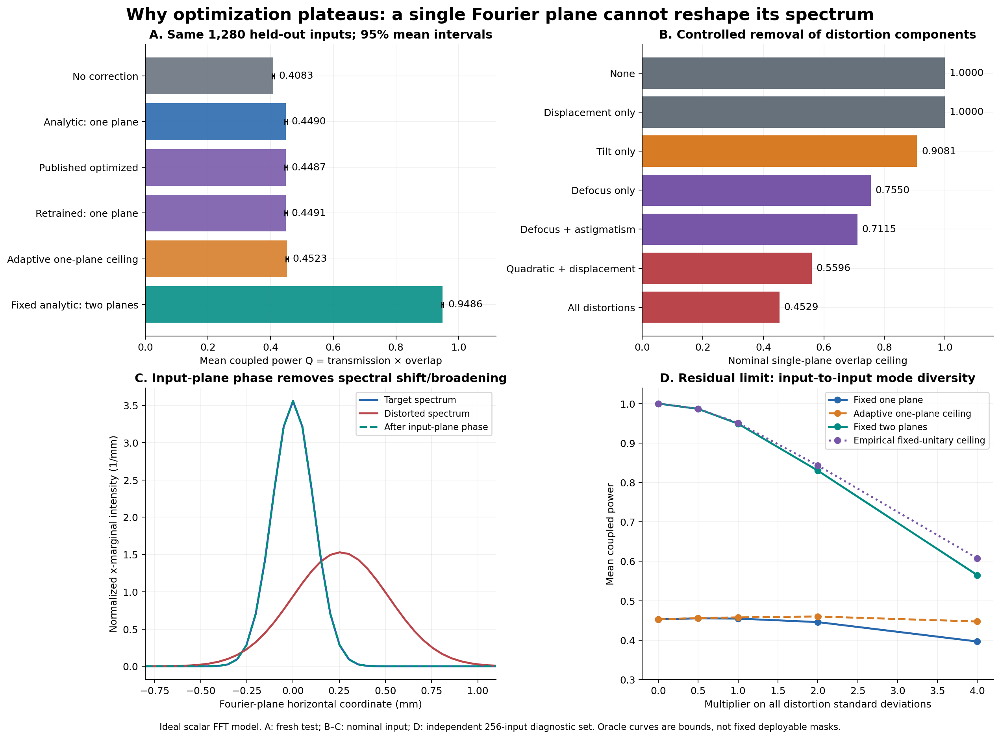

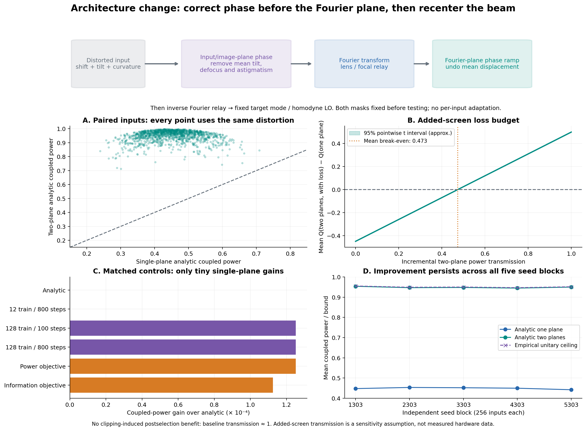

[Evidence and safe reproduction guide](../investigations/phase_limit/README.md) · [Physics of the ceiling](../docs/PHYSICS.md) · [Panel-by-panel figure guide](../docs/FIGURE_GUIDE.md)

The scientific story below preserves the original baseline before the new diagnosis. Different test-set means reflect different random draws, not replacement of the archive.

[Read the scientific story](#scientific-story) · [Browse the complete report](../results/report.md) · [Reproduce](#reproduce-the-study) · [Numerical evidence](#numerical-evidence) · [Limits](#scope-and-limitations)

## IEEE-style paper

**Afam Madu and Tofayel Karim**, *Fourier-Domain Spatial-Mode Conditioning for Coherent Optical Communication: A Reproducible Numerical Study*.

[Read the paper (PDF)](../paper/main.pdf) · [Classroom speaking script (PDF)](../paper/classroom-presentation-script.pdf) · [LaTeX source](../paper/main.tex) · [Build instructions and figure order](../paper/README.md) · [Manuscript verification](../paper/VERIFICATION.md)

The two-column IEEEtran manuscript integrates the ten archived plots and the two new investigation figures, with equations, results tables, verification evidence, and limitations. It is not an accepted IEEE publication or externally peer-reviewed article.

## At a glance

| Item | Archived baseline |
|---|---|
| Optical model | Ideal sampled 2D scalar paraxial 4f relay, 1550 nm, 128 × 128 grid |
| Correction | Fourier-plane phase-only mask; fixed analytic and trained baselines |
| Optimization | 3 initializations, 100 iterations; 12 train / 12 validation / 24 independent test distortions |
| Detection | One-quadrature homodyne; 100,000 symbols per principal case |
| Quantum cross-check | Actual Strawberry Fields Gaussian backend: 22 vacuum/coherent pure-loss cases |
| Verification | 41 local automated tests passed; independent numerical reference checks |
| Outputs | 10 figures in PNG/SVG, interpreted report, arrays, metrics, configuration, hashes |

**“Verified” here means numerically tested against stated analytical models and an independent software backend—not experimental validation or peer review.** Code reviews are internal engineering checks, not external scientific endorsement.

## Scientific story

Follow the sequence below. Each step links directly to its figure and underlying evidence. Figure numbers retain their original generation order; the reading order puts quantum validation before performance interpretation.

### 1. What is the question—and where does the model stop?

**Can a phase-only Fourier-plane mask improve receiver spatial-mode matching under displacement, tilt, defocus, and astigmatism?**

The 4f relay transforms a coherent field into a Fourier plane, applies a finite pupil and phase mask, and transforms back. The receiver projects onto a specified local-oscillator mode. Classical propagation determines coupling; a separate Gaussian quantum/noise model describes the detected quadrature.

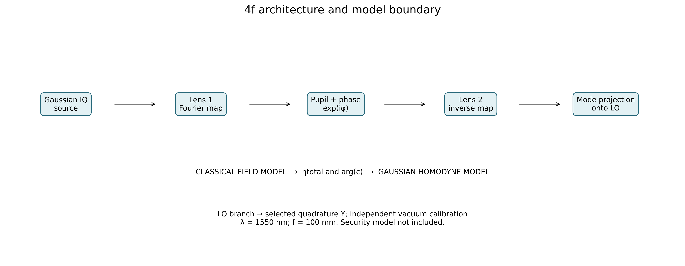

[Figure 1: SVG](../results/figures/01_architecture.svg) · [Physics and conventions](../docs/PHYSICS.md) · [Baseline configuration](../results/config.json)

### 2. Verify the optical calculation before trusting an optimization

Physical pixel areas are included in normalization; Fourier coordinates obey `x_F = wavelength × focal_length × spatial_frequency`. Throughput and normalized mode overlap are separate quantities. Production uses TorchOptics field modulation with differentiable Fourier operators, compared with independent NumPy calculations.

Tests cover FFT round trips, power conservation, Gaussian Fourier profiles, overlap bounds, gradients of the actual objective, and NumPy/TorchOptics agreement. The additional Fresnel propagation check has relative error approximately **4.12 × 10⁻¹⁶** for the archived case; this is numerical agreement, not a discretization-convergence study.

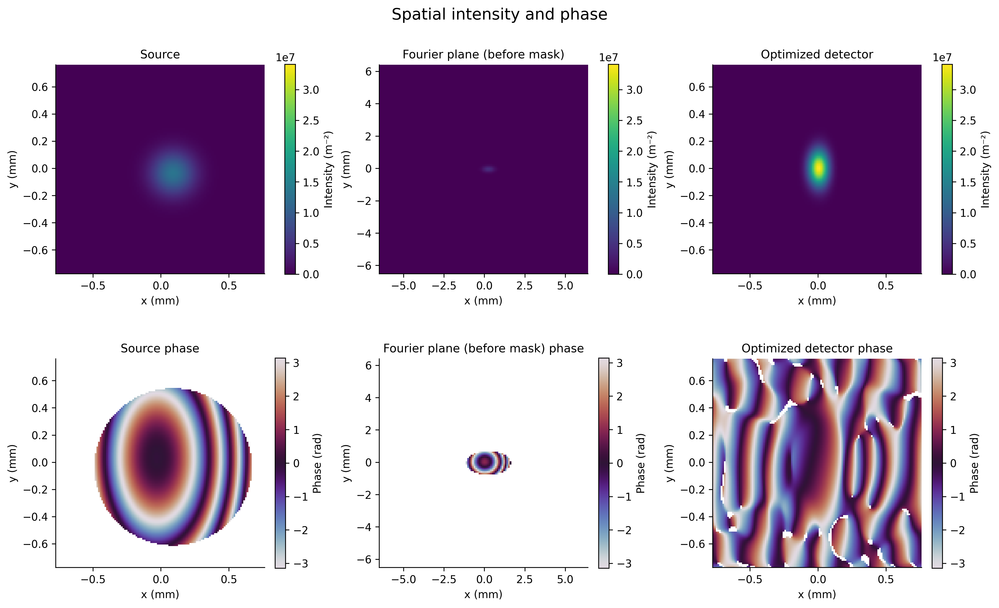

[Figure 2: SVG](../results/figures/02_fields.svg) · [Acceptance tests](../tests/test_acceptance.py) · [Core tests](../tests/test_core.py) · [Recorded validation metrics](../results/metrics.json)

### 3. What changes when we correct the distorted field?

Compare the ideal reference, distorted/no-mask input, analytic phase alignment, trained mask, and deliberately lossy case. **These images show representative cases, not test-distribution averages.** A visually improved field is not by itself evidence of generalization.

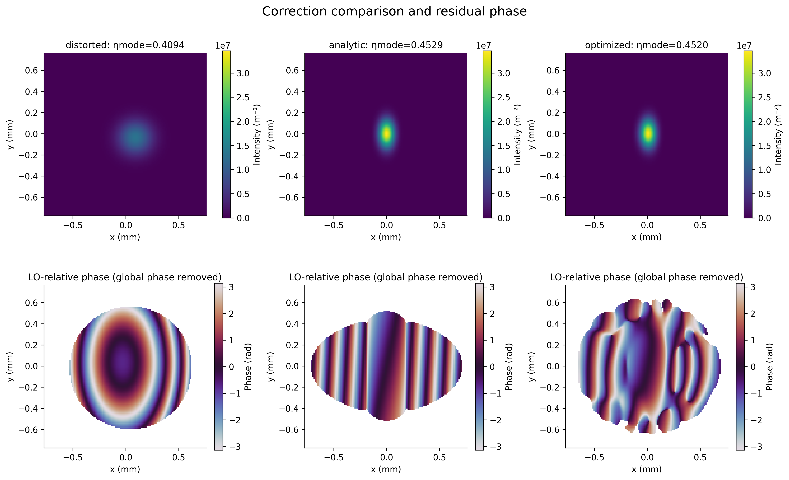

[Figure 3: SVG](../results/figures/03_comparison.svg) · [Representative-case numerical table](../results/tables/cases.csv)

The trained object is a **phase-only** map, not an amplitude amplifier or a fabricated phase plate. The saved array is in radians; it is not a calibrated etch-depth design.

<details>
<summary>Inspect the trained phase mask — Figure 4</summary>

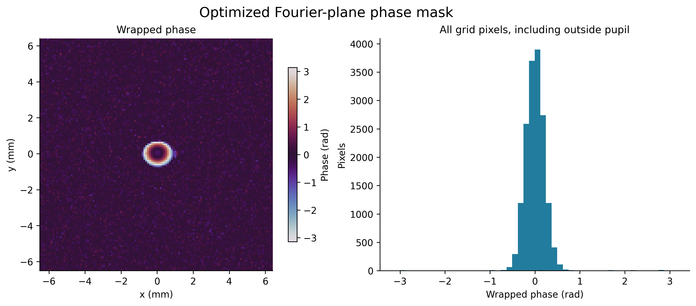

[SVG](../results/figures/04_mask.svg) · [Phase array (.npy)](../results/arrays/optimized_phase_rad.npy)

</details>

### 4. Does it generalize beyond the training fields?

Training and validation curves show the optimization process across initializations. Validation selects the checkpoint; a separate test seed evaluates the final mask. Tolerance heatmaps expose behavior beyond one representative field.

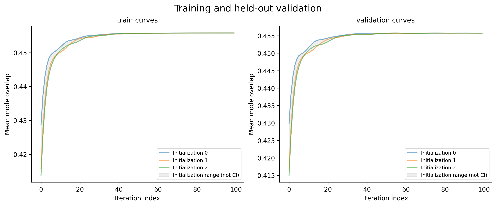

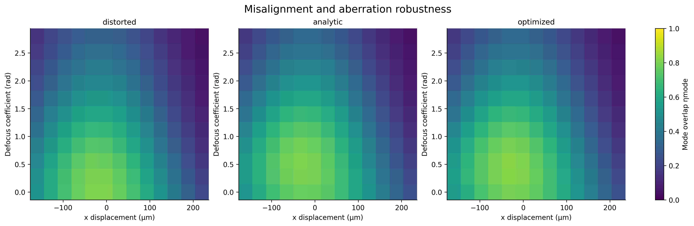

[Figure 5: SVG](../results/figures/05_learning.svg) · [Figure 6: SVG](../results/figures/06_robustness.svg)

**Independent test set: 24 distortion realizations**

| Correction | Mean normalized mode overlap |
|---|---:|
| No mask | 0.431225 |
| Fixed analytic correction | 0.469958 |
| Trained phase-only mask | 0.470226 |

| Paired comparison | Mean overlap difference | 95% Student-t confidence interval | Supported conclusion |
|---|---:|---:|---|
| Trained − no mask | +0.039001 | [+0.035802, +0.042199] | Improvement in this tested distribution |
| Trained − analytic | +0.000268 | [−0.001372, +0.001907] | **No demonstrated advantage over analytic correction** |

These intervals describe paired variation across test distortions, not fabrication uncertainty or performance under arbitrary conditions. The analytic baseline is a fixed mask derived from the representative distortion, not an oracle that adapts to each test sample.

Evidence: `test_distribution` and `paired_test_improvements` in [metrics.json](../results/metrics.json); per-realization overlaps in [data.npz](../results/arrays/data.npz).

### 5. Verify the quantum limit independently

Under passive pure loss, coherent quadrature means scale as `sqrt(T)`, while vacuum/coherent conditional variance remains **1 SNU**. Strawberry Fields independently checks both quadrature means and covariance for 22 cases. Its maximum mean error against theory is **2.22 × 10⁻¹⁶**, with zero recorded covariance error.

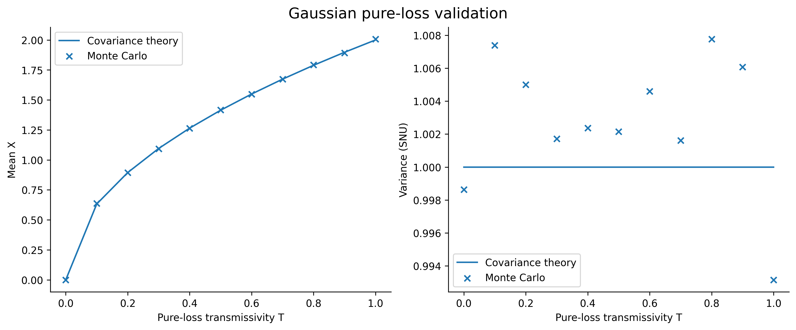

The plotted empirical samples are **NumPy Monte Carlo**, not Strawberry Fields measurement samples. Strawberry Fields independently verifies the underlying Gaussian moments. Small Monte Carlo departures from 1 SNU are finite-sample fluctuations, not squeezing.

[Figure 10: SVG](../results/figures/10_quantum.svg) · [Quantum-backend method and compatibility](../docs/QUANTUM_BACKEND.md) · [Backend tests](../tests/test_quantum_backend.py)

### 6. Translate optical coupling into observable homodyne statistics

With phase compensation enabled in this baseline:

```text
eta_total = T_channel × T_opt × eta_mode × eta_detector
Y = sqrt(eta_total) × X_A + Z
Var(Z) = 1 + xi_rec + v_el
Var(Y) = eta_total × V_A + 1 + xi_rec + v_el
SNR = eta_total × V_A / (1 + xi_rec + v_el)
```

Here `V_A = 4`, `xi_rec = 0.02`, and `v_el = 0.01`. The homodyne comparison includes excess/electronic noise; the separate pure-loss quantum check above does not. Increasing received signal variance can improve SNR while the vacuum contribution remains unchanged.

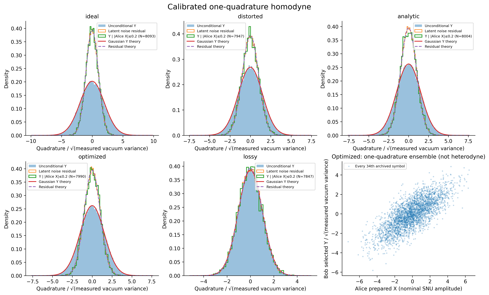

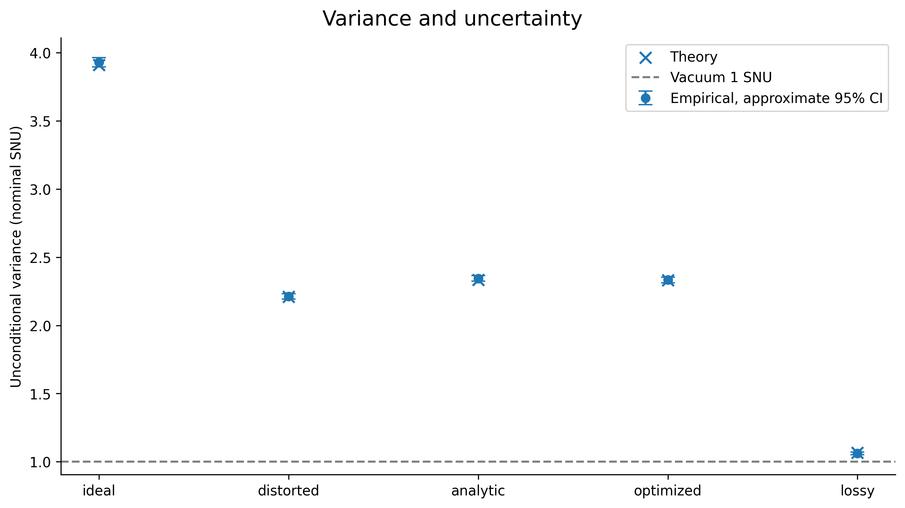

The scatter represents one measured Bob quadrature versus Alice's prepared variable—not simultaneous X/P detection or heterodyne. Conditional histograms are selected from a finite Alice interval, not an exact delta-conditioned state.

[Figure 7: SVG](../results/figures/07_homodyne.svg) · [Figure 8: SVG](../results/figures/08_variance.svg) · [Homodyne implementation](../src/homodyne.py)

### 7. What is gained, and what cannot be recovered?

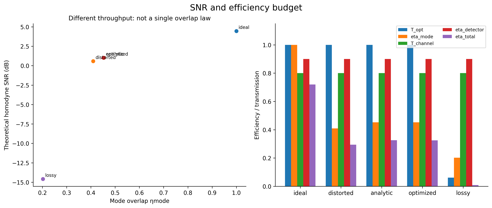

Better spatial matching increases detected signal efficiency, not total photon number. The plotted empirical SNR is a **known-component Monte Carlo diagnostic**, not an independently inferred receiver estimator.

The failure case combines half-plane occlusion with attenuation. Its throughput is approximately **0.061736** relative to the original input. Even the attainable phase-only normalized-overlap ceiling is only **0.243860**, determined by Fourier-magnitude mismatch; the associated coupled-power ceiling is approximately **0.015055**. Phase optimization cannot reverse the lost power or arbitrarily reshape Fourier magnitudes.

[Figure 9: SVG](../results/figures/09_snr.svg) · [Loss-case bounds in metrics](../results/metrics.json) · [Full interpretation of every figure](../results/report.md)

**Conclusion:** this baseline supports phase correction over no correction for the chosen distortions. It does not establish superiority over a good analytic correction, quantum security, sub-shot-noise operation, or fabrication readiness.

## Numerical evidence

| What you want | Where to go |
|---|---|
| Complete scientific interpretations | [Report](../results/report.md) / [HTML file](../results/report.html) — download HTML and open locally |
| All figures | [PNG and SVG gallery](../results/figures/) / [Figure guide](../docs/FIGURE_GUIDE.md) |
| Machine-readable claims | [Metrics](../results/metrics.json) and [representative cases CSV](../results/tables/cases.csv) |
| Full configuration and seeds | [Saved configuration](../results/config.json) / [user configuration](../configs/baseline.yaml) |
| Raw numerical evidence | [data.npz](../results/arrays/data.npz), including complex fields, samples, learning curves and test overlaps |
| Reproducibility and export history | [Manifest](../results/manifest.json) / [Publication provenance](../docs/PUBLICATION.md) |
| Verification | [Tests](../tests/) / [Recorded test output](../results/logs/tests.txt) |
| Engineering reviews | [Specification review](../docs/SPEC_REVIEW.md) / [Code review](../docs/CODE_REVIEW.md) |
| Theory and dependencies | [Physics](../docs/PHYSICS.md), [references](../docs/REFERENCES.md), [dependency status](../docs/DEPENDENCY_STATUS.md) |
| Future experimental work | [Fabrication roadmap](../docs/FABRICATION_ROADMAP.md) |

Load the archive safely with `numpy.load('results/arrays/data.npz', allow_pickle=False)`. The archive is committed so the published claims can be inspected without rerunning training.

## Reproduce the study

Prerequisite: [uv](https://docs.astral.sh/uv/getting-started/installation/), Linux, and network access for package installation. CPU-only operation is supported; no CUDA driver or system-Python modification is required.

```bash
git clone https://github.com/MADjnr/fourier-quantum-communication.git
cd fourier-quantum-communication
bash scripts/setup_linux.sh
.venv/bin/python -m pytest -q
# Preserve the published baseline; write your run elsewhere:
.venv/bin/python -m src.run --config configs/baseline.yaml --output runs/reproduction
# Regenerate only your report from your saved arrays:
.venv/bin/python -m src.run --output runs/reproduction --report-only
# Verify published file hashes without installing scientific dependencies:
python3 scripts/verify_artifacts.py
```

Setup creates **project-local** `.venv` and `.venv-sf` using Python 3.11.12 and exact version freezes. It synchronizes those environments, removing unlisted packages. PyTorch is pinned CPU-only; Strawberry Fields is isolated and includes its required setuptools compatibility pin. Do not reuse these environment names for unrelated work.

`make setup`, `make test`, `make run`, `make report`, and `make all` are available. Override `OUTPUT` to preserve archived results. Matplotlib runs headlessly; plots are at least 300 dpi PNG plus SVG. Results may vary slightly across numerical-library/platform combinations. A new-machine installation has not been exhaustively tested.

If Strawberry Fields cannot execute, the code records the error and explicitly labels the covariance fallback. **The committed baseline actually executed Strawberry Fields.** Its package version is recorded in `metrics.json → quantum_validation.sf_versions`; the main-environment manifest can correctly say Strawberry Fields is absent because it runs in a separate environment.

## Scope and limitations

- Ideal scalar paraxial focal-plane mapping, not full-vector Maxwell simulation or explicit lens-by-lens finite-distance propagation.
- The investigation adds window/pitch convergence checks on 32 diagnostic inputs for analytic architectures and bounds; it does not retrain every optimized mask on every grid or establish realistic lens/aperture convergence.
- Finite training/test sets; no universal claim across arbitrary distortions or mask constraints.
- Baseline pupil clipping is negligible for most non-lossy cases; this is not a stress test of finite-aperture loss.
- Phase compensation and calibrated noise are assumed as documented; practical estimation errors need separate study.
- Confidence intervals are provided for selected statistics, not every plotted point or SNR estimator.
- No measured device data, fabricated mask, calibrated phase-to-depth conversion, secure key rate, squeezing, or entanglement is claimed.
- Next steps: calibrate and test the two-plane analytic architecture with measured transmission; quantized/feature-limited masks, alignment and bandwidth errors, and measured aberration distributions. Adaptive or multimode reception needs a separate measurement/control analysis.

The repository is public for inspection. Public visibility alone does not grant an open-source license; no license has been selected yet.
